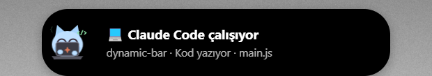
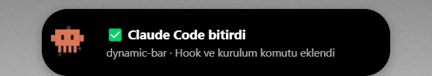
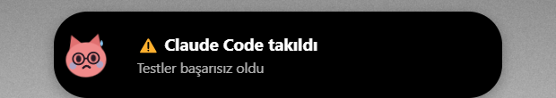
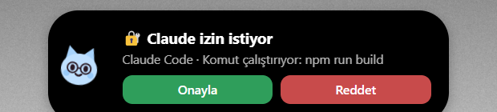
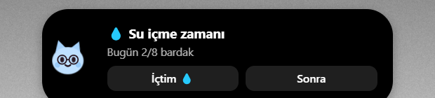
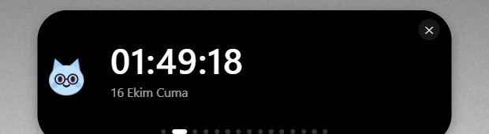

# Dynamic Bar

Ekranın üstünde duran, Dynamic Island tarzı küçük bir bar. İçinde bir maskot yaşar: bildirimleri gösterir, müziği
kontrol eder, saatini ve takvimini tutar. En özel yanı **Claude Code ile çalışması**: Claude kod yazarken maskot laptop
açıp yazı yazar, iş bitince haber verir, izin isterken karar vermeni bardan sağlar.

> Yalnızca Windows 10/11. Electron ile yazıldı.

| Claude çalışıyor | Bitirdi | Takıldı |
|---|---|---|
|  |  |  |

| Bardan onay | Su içme | Panel |
|---|---|---|
|  |  |  |

## Özellikler

**Claude Code**
- **Canlı durum:** Claude çalışırken maskot laptop açıp kod yazar; barda "Kod yazıyor · main.js", "Komut çalıştırıyor", "İnternette arıyor" gibi durum görünür.
- **Bitiş bildirimi:** "Claude Code bitirdi" başlığı ve en çok 10 kelimelik özet (isteğe bağlı olarak Haiku ile üretilir). Maskot Claude Code maskotuna dönüşüp geri döner.
- **Bardan onay:** Claude izin isteyince Onayla / Reddet düğmeleri çıkar. Yanıtlamazsan terminaldeki soru geçerli kalır.
- **Hata durumu:** İş takılırsa maskot üzülür ve başlık "Claude Code takıldı" olur.
- **Günlük özet:** Panelde bugünkü görev sayısı ve çalışma süresi, 21:00'den sonra özet bildirimi.
- **Odak modu:** Pomodoro odak turunda Claude bildirimleri beklenir, onay istekleri anında gelir.

**Genel**
- Maskotun günlük yaşamı: sabah esner, öğlen acıkır, gece uykulu olur.
- Su içme hatırlatıcısı: "İçtim" düğmesi, günlük hedef ve seri.
- Toplantı modu: takvimde (ICS) etkinlik varken bildirimler susar, bitince kaçırdıkların özetlenir.
- Medya kontrolü, saat, takvim, pomodoro, kronometre, yapılacaklar, hava, döviz, dünya saatleri, pano geçmişi ve daha fazlası.
- Yerel API (`127.0.0.1:47800`): her program bildirim gönderebilir. Ayrıntı: [API.md](API.md).

## Kurulum

### Hazır paket
`npm run dist` ile `dist/` içinde kurulum (`Dynamic Bar Setup.exe`) ve taşınabilir sürüm üretilir.

### Kaynaktan
```
npm install
npm start
```
Gereksinimler: Node.js 18+, Windows 10/11. `koffi` kurulu değilse sanal masaüstü desteği kısıtlı çalışır (bar bunu söyler).

### Claude Code bağlantısı
```
node cli.js setup-claude         # hook'ları ~/.claude/settings.json dosyasına ekler (önce yedek alır)
node cli.js setup-claude --remove
```
Ya da tray menüsünden **"Claude Code hook'larını kur"**. Sonra Claude Code oturumunu yeniden başlat.
Hook'lar `node` ister (PATH'te olmalı). Üç özelliği (canlı durum, bardan onay, yapay zekâ özeti) **Ayarlar > Claude Code** bölümünden ayrı ayrı kapatabilirsin.

İsteğe bağlı komut satırı aracı: `npm link` sonra `dynbar notify "Bitti"`, `dynbar run npm test`, `dynbar water` ...

## Kullanım

- Adaya tıkla veya `Ctrl+Alt+B`: panel açılır. İki parmakla kaydırarak sayfa değiştir.
- Tray simgesi: ayarlar, rahatsız etme, test bildirimleri, **günlüğü aç**.
- `Ctrl+Alt+N`: test bildirimi.

## Sorun giderme

| Belirti | Çözüm |
|---|---|
| Bar görünmüyor | Tam ekran uygulama olabilir (Ayarlar > "Tam ekranda gizle"). Tray > Günlüğü aç. |
| Claude durumu gelmiyor | `node cli.js setup-claude` çalıştır, Claude Code'u yeniden başlat. Rahatsız etme açık olmasın. |
| 4 parmak hareketi sonrası tıklama tepkisiz | `npm install` yapıldığından emin ol (`koffi`). Bar kendi yedek tıklamasını kullanır. |
| `npm run dist` EBUSY hatası | OneDrive içinde derlerken olur: `npx electron-builder --win -c.directories.output=C:/Temp/dist` |

## Geliştirme

Yapı: `main.js` (ana süreç, API, tıklama bölgesi), `renderer.js` + `index.html` (ada ve maskot), `extras*.js` (sayfalar, hatırlatıcılar),
`integrations/claude-code-hook.js` (Claude Code), `scripts/*.ps1` (Windows izleyicileri), `vdesk.js` (sanal masaüstleri).
Yol haritası: [ROADMAP.md](ROADMAP.md).

## Lisans

MIT, bkz. [LICENSE](LICENSE).
